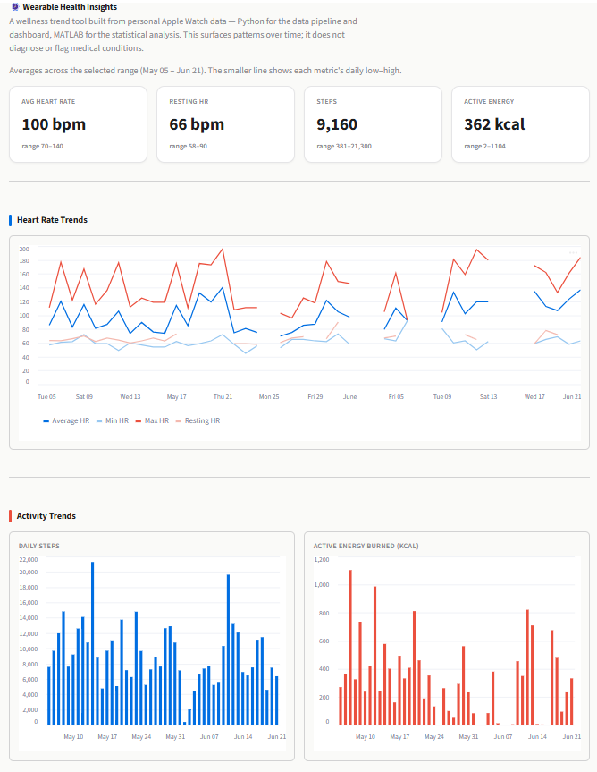
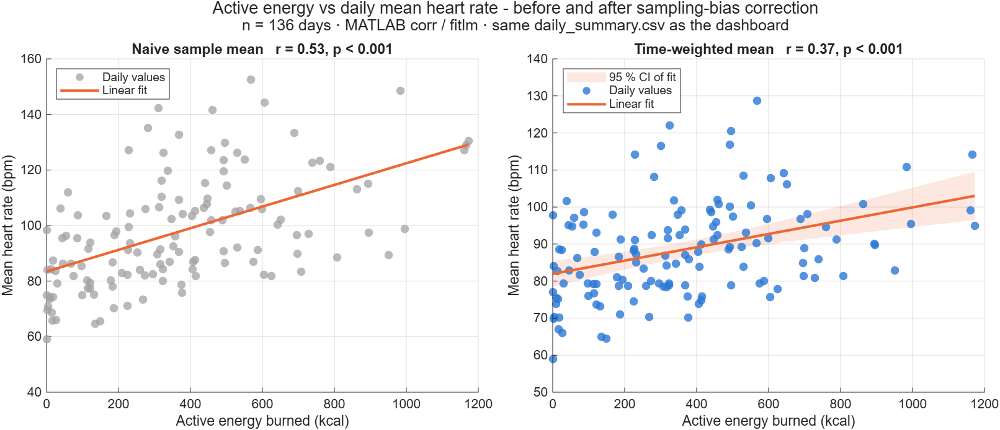

# ⌚ Wearable Health Insights Dashboard

A Python + Streamlit pipeline that turns a raw Apple Watch health export into a clean, interactive dashboard of heart-rate and activity trends — with the statistical analysis run in MATLAB. It runs on my own real recorded data.


> A wellness **trend** tool, not a diagnostic one. It surfaces patterns in personal data; it does not interpret or flag medical conditions.



---

## Overview

Apple Health exports a single `export.xml` file that can run to hundreds of megabytes and hold years of mixed-device sensor data. This project ingests that file, reduces tens of thousands of raw readings to a tidy day-by-day summary, and presents it as an Apple Health-inspired dashboard. A separate MATLAB step adds a small statistical study of how activity relates to heart rate.

It is built to demonstrate an end-to-end workflow: **data engineering in Python, statistics in MATLAB, and presentation in Streamlit** — the kind of cross-toolchain pipeline common in biomedical signal-processing work. The dashboard and the analysis figure are both drawn from the same real 48-day recording, so what you see in the trend charts is the same data behind the correlation result.

## What it does

- Streams a large `export.xml` into clean per-metric CSVs without loading the whole file into memory.
- Aggregates raw readings into a daily summary (average / min / max heart rate, resting heart rate, total steps, active energy).
- Renders an interactive dashboard with a filterable date range, at-a-glance metric cards, and trend charts.
- Surfaces a MATLAB correlation/regression analysis of active energy vs. heart rate directly in the dashboard.

## Key finding

Across the recorded period, **active energy burned shows a statistically significant positive correlation with average heart rate (R = 0.54, p < 0.001, R² ≈ 0.29)** — days with more energy burned tend to run a higher average heart rate.

By contrast, **simple step count showed no significant relationship with heart rate.** That null result is reported as a real finding, not a failed test: step count measures movement *volume*, while active energy captures *intensity*, which is what actually tracks with heart rate.



## Engineering decisions worth noting

- **Streaming XML parsing.** `parse_health_data.py` uses `iterparse` and clears each element after reading it, so memory stays flat regardless of export size.
- **Scoped to the valid data range.** Raw exports often include sparse, partial data from older devices (e.g. pre-Watch iPhone step counts). The pipeline scopes analysis to the period with consistent wearable data, applying that filter at the presentation boundary so the aggregation logic stays clean.
- **Aggregated, not raw.** The repo publishes the day-level `daily_summary.csv` that drives the dashboard; the underlying minute-by-minute exports stay local (git-ignored), so the published data is coarse-grained by design.
- **Deliberate Python + MATLAB split.** Python handles all data engineering and rendering; MATLAB does the statistics and exports a figure the dashboard reads. The boundary is intentional and interview-defensible.

## Tech stack

| Layer | Tools |
|-------|-------|
| Data engineering | Python, pandas, ElementTree (`iterparse`) |
| Dashboard | Streamlit |
| Statistics | MATLAB (Statistics and Machine Learning Toolbox) |

## Project structure

```
wearable-health-dashboard/
├── parse_health_data.py        # Streams export.xml -> per-metric CSVs
├── build_daily_summary.py      # Aggregates raw readings into a daily summary
├── correlation_analysis.m      # MATLAB: correlation + regression, exports the figure
├── app.py                      # Streamlit dashboard
├── daily_summary.csv           # Day-level Apple Watch summary the dashboard reads
├── energy_vs_hr_correlation.png# Saved MATLAB figure shown in the dashboard
├── dashboard.png               # Dashboard screenshot (README hero image)
├── requirements.txt
├── LICENSE
└── README.md
```

## Getting started

### Run the dashboard

```bash
pip install -r requirements.txt
streamlit run app.py
```

The dashboard reads the included `daily_summary.csv`, so it works straight after cloning.

### Rebuild from your own Apple Watch data

1. On your iPhone: **Health app → profile icon → Export All Health Data**.
2. Unzip the export and place `export.xml` in the project folder (or update the path in `parse_health_data.py`).
3. Regenerate the data and launch the dashboard:

```bash
pip install -r requirements.txt
python parse_health_data.py
python build_daily_summary.py
streamlit run app.py
```

This rebuilds `daily_summary.csv` from your own export.

### Reproduce the statistical analysis (optional)

With MATLAB and the Statistics and Machine Learning Toolbox installed, run `correlation_analysis.m` from the project folder. It reads `daily_summary.csv`, prints the correlation results, and re-exports `energy_vs_hr_correlation.png`.

## Roadmap

This repository is **Phase 1**: the complete software pipeline and dashboard, running on real data. The hardware items below are **planned for Phase 2 and have not been built yet** — they're listed to show where the project is headed, not to claim completed work.

**Phase 2 — Hardware (planned)**

- [ ] PPG heart-rate sensor prototype (ESP32 + optical sensor) to capture pulse data independently of the Apple Watch
- [ ] SolidWorks-designed enclosure for the sensor
- [ ] A dedicated dashboard page for the sensor's own captured data

**Other ideas**

- [ ] Resting-heart-rate recovery view
- [ ] Sleep / recovery insights (pending more consistent sleep-tracking data)

## Author

**Nabeel Abdel** — Biomedical Engineering, San José State University
GitHub: [@NabeelAbdel](https://github.com/NabeelAbdel)

## License

Released under the [MIT License](LICENSE).
