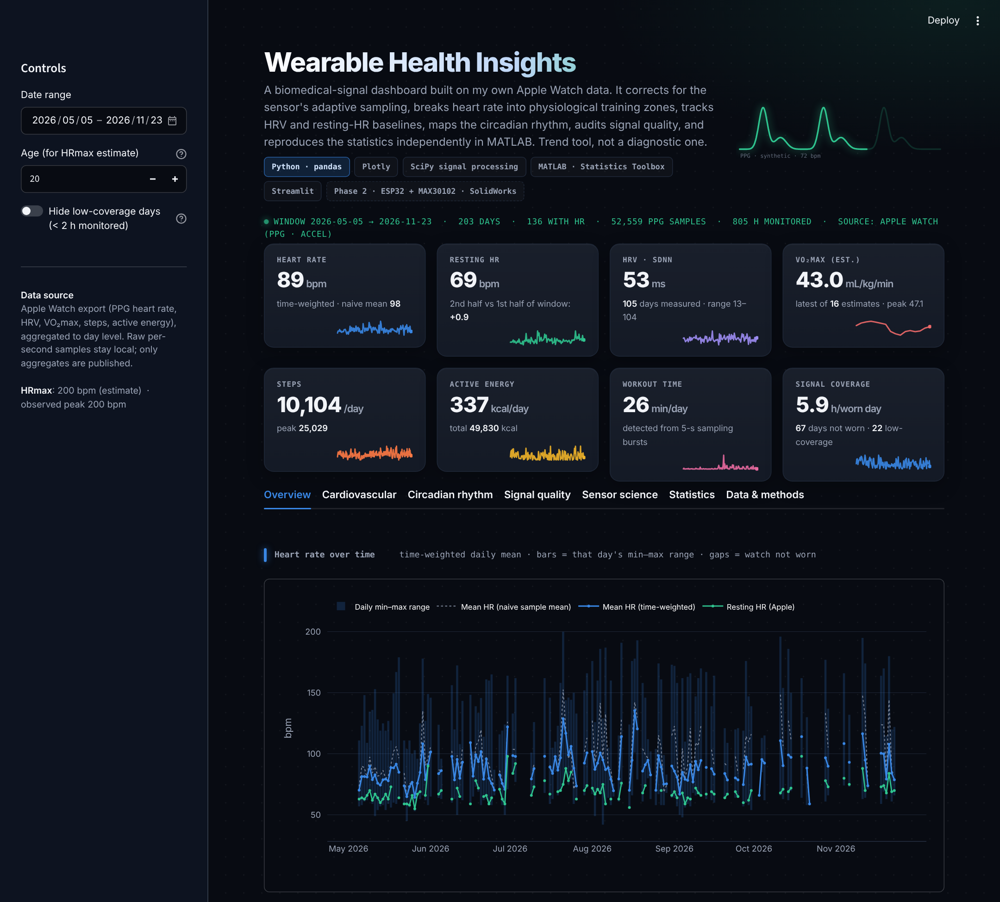
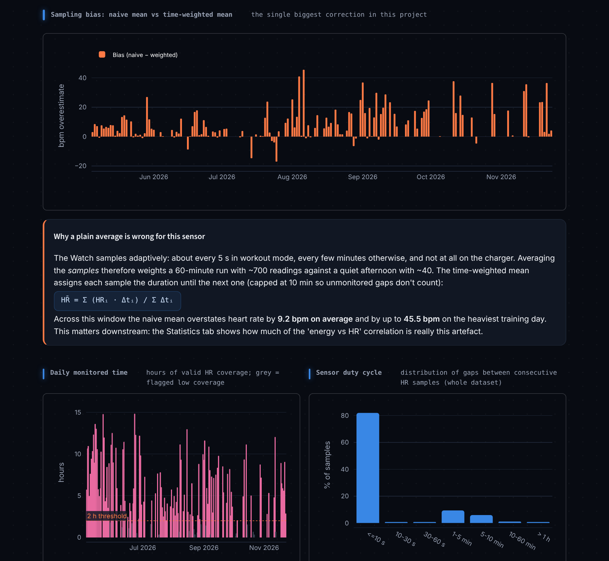
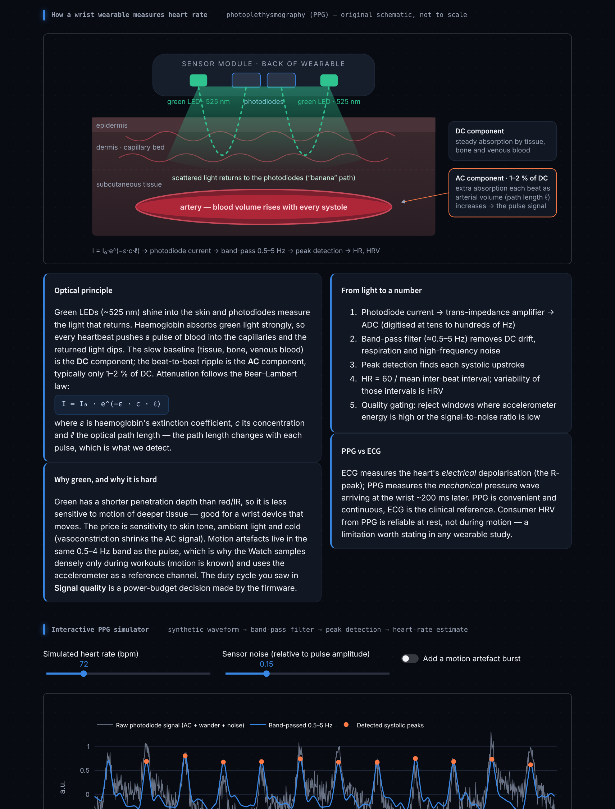

# Wearable Health Insights Dashboard

A biomedical-signal analysis pipeline and interactive dashboard built on my own Apple Watch data. It streams a 100+ MB Apple Health export into clean daily metrics, **corrects for the sensor's adaptive sampling**, breaks heart rate into physiological training zones, tracks HRV and resting-HR baselines, maps the circadian rhythm, audits signal quality, explains the optics of the PPG sensor with a live simulator, and reproduces the statistics independently in MATLAB.

[](https://nabeel-health-dashboard.streamlit.app/)


> A wellness **trend** tool, not a diagnostic one. It surfaces patterns in one person's data; it does not interpret or flag medical conditions.

**Live demo:** [nabeel-health-dashboard.streamlit.app](https://nabeel-health-dashboard.streamlit.app/)



---

## Key finding: half of the headline correlation was a sampling artefact

The Apple Watch does not sample heart rate at a fixed rate. In workout mode it records roughly every **5 seconds**; at rest, every few minutes; on the charger, nothing. In this dataset **82 % of all heart-rate samples arrive ≤ 10 s apart**, yet those samples cover only a fraction of the day.

A plain `mean()` of the samples therefore over-weights exercise. Replacing it with a **time-weighted mean** — each sample weighted by how long it is in force, capped at 10 min so unmonitored gaps don't count —

$$\bar{HR} = \frac{\sum_i HR_i \cdot \Delta t_i}{\sum_i \Delta t_i}$$

lowers the daily mean by **9.2 bpm on average** (up to 46 bpm on the heaviest training day) across 203 days of data (136 with the watch worn, 52,559 heart-rate samples).

That correction changes the headline statistic:

| Active energy vs daily mean HR (n = 136 days) | Pearson *r* | R² | Spearman *ρ* |
|---|---|---|---|
| naive sample mean | 0.53 | 0.28 | 0.57 |
| **time-weighted mean (corrected)** | **0.37** | **0.14** | **0.41** |

Both are statistically significant (p < 0.001), but the corrected effect is half the size: **about 51 % of the apparent explained variance was the sensor sampling more on workout days**, which inflates the naive mean and active energy together — a confound, not physiology. Active energy really does track mean heart rate, but it explains ~14 % of the day-to-day variance, not ~28 %.

This project started on a 48-day export. At n = 39 the corrected correlation was not significant (r = 0.27, p = 0.10); extending to a 203-day export resolved it. Reporting the under-powered pilot honestly, then collecting more data, is the workflow I'd want to show.

**Other results (same 203-day window)**

| Comparison | n | Pearson *r* | *p* | Reading |
|---|---|---|---|---|
| HRV (SDNN) vs resting HR, same day | 100 | −0.35 | < 0.001 | Expected autonomic coupling: more vagal tone → slower resting heart and more variability |
| Steps vs mean HR (negative control) | 136 | 0.17 | 0.054 | Not significant: movement volume ≠ intensity |
| Training load (TRIMP) vs next-day resting HR | 75 | 0.15 | 0.22 | No detectable next-day effect |
| Training load (TRIMP) vs next-day HRV | 76 | −0.01 | 0.95 | No detectable next-day effect |



## What the dashboard contains

| Tab | What it shows | Biomedical concepts |
|---|---|---|
| **Overview** | Time-weighted vs naive mean HR with daily min–max envelope, resting HR, steps, active energy | Non-uniform sampling, volume vs intensity |
| **Cardiovascular** | Minutes per day in five HR zones (stacked), zone table with physiology, Edwards TRIMP training load, resting-HR and HRV (SDNN) baselines with ±1 SD bands and 2 SD anomaly flagging, VO₂max estimate trend | %HRmax zones, training impulse, heart-rate variability, autonomic recovery, cardiorespiratory fitness |
| **Circadian rhythm** | Date × hour heatmap of time-weighted HR, average 24-h profile with IQR band, monitoring density per hour | Circadian autonomic rhythm, nocturnal vagal dominance |
| **Signal quality** | Per-day sampling bias, monitored hours with low-coverage flags, histogram of inter-sample gaps (sensor duty cycle) | Signal-integrity reporting, adaptive sampling / power budget |
| **Sensor science** | How PPG works (Beer–Lambert, AC/DC components, green vs red/IR light, motion artefacts, PPG vs ECG) and an **interactive simulator**: synthetic PPG → Butterworth band-pass → peak detection → HR and SDNN estimate, with noise and motion-artefact controls | Photoplethysmography, filtering, peak detection, HRV |
| **Statistics** | Live Pearson/Spearman table for five hypotheses, scatter with OLS fit and 95 % CI, the MATLAB reproduction figure | Hypothesis framing, confounding, robustness checks, cross-tool verification |
| **Data & methods** | Pipeline diagram, methods, stated limitations, full daily table with CSV download | Reproducibility |



## Pipeline

```
export.xml (Apple Health, 100s of MB)
   │  parse_health_data.py — streaming iterparse, flat memory
   ▼
heart_rate · steps · active_energy · resting_heart_rate · hrv_sdnn · vo2_max .csv   (raw, git-ignored)
   │  build_daily_summary.py — local-time days, time-weighted HR, zones, TRIMP, coverage
   ▼
daily_summary.csv · hourly_hr.csv · sampling_profile.csv                   (aggregates, published)
   │                                   │
   │  app.py (Streamlit + Plotly + SciPy)   │  correlation_analysis.m (MATLAB)
   ▼                                   ▼
interactive dashboard  ◄──────────  energy_vs_hr_correlation.png
```

## Engineering decisions worth noting

- **Streaming XML parsing.** `parse_health_data.py` uses `ElementTree.iterparse` and clears each element after reading it, so memory stays flat regardless of export size. It also extracts HRV (SDNN) and VO₂max when an export contains them.
- **Local-time day boundaries.** Apple stamps each record with a UTC offset. Bucketing days in UTC (the first version's bug) pushed every evening workout into the next calendar day; days are now formed in the wearer's time zone.
- **Time-weighted aggregation.** Described above. The naive mean is kept as a second column so the bias is visible in the data, not just claimed in prose.
- **Gaps are left as gaps.** The watch was not worn on 67 of 203 days. Those days have no heart-rate values; charts break across them, nothing is interpolated, and "next-day" comparisons pair consecutive calendar days only.
- **Signal-integrity columns.** Every daily row carries `hr_samples`, `monitored_hours` and a `low_coverage` flag; the dashboard greys out thin days rather than silently dropping them.
- **Workout detection from sampling cadence.** Samples ≤ 15 s apart only occur in workout mode, so the sensor's own duty cycle yields a workout-minutes estimate without needing Apple's workout log (Spearman ρ = 0.69 against active energy; Pearson is only 0.35 because one day with a workout left running is an outlier — a limitation of the proxy).
- **Aggregated, not raw, in the public repo.** Minute-level exports stay local and git-ignored; only day- and hour-level aggregates are published.
- **Deliberate Python + MATLAB split.** Python handles data engineering and rendering; MATLAB re-computes the statistics from the same CSV and exports a figure the dashboard displays. Two independent toolchains agreeing on one answer is the verification habit used in regulated device work.

## Tech stack

| Layer | Tools |
|---|---|
| Data engineering | Python 3.12, pandas, NumPy, `ElementTree.iterparse` |
| Signal processing & statistics | SciPy (`signal.butter`, `sosfiltfilt`, `find_peaks`, `stats`) |
| Dashboard | Streamlit, Plotly |
| Independent statistics | MATLAB (Statistics and Machine Learning Toolbox: `corr`, `fitlm`, `predict`) |

## Project structure

```
wearable-health-dashboard/
├── parse_health_data.py         # Streams export.xml -> per-metric CSVs
├── build_daily_summary.py       # Raw readings -> daily_summary / hourly_hr / sampling_profile
├── correlation_analysis.m       # MATLAB: naive vs corrected correlation, OLS + 95 % CI figure
├── app.py                       # Streamlit dashboard (7 tabs)
├── .streamlit/config.toml       # Dark theme
├── daily_summary.csv            # One row per day (published)
├── hourly_hr.csv                # One row per date x hour (published)
├── sampling_profile.csv         # Histogram of inter-sample gaps (published)
├── energy_vs_hr_correlation.png # Saved MATLAB figure shown in the dashboard
├── docs/                        # Screenshots for this README
├── requirements.txt
├── LICENSE
└── README.md
```

## Getting started

### Run the dashboard

```bash
pip install -r requirements.txt
streamlit run app.py
```

The dashboard reads the included aggregate CSVs, so it works straight after cloning.

### Rebuild from your own Apple Watch data

1. On your iPhone: **Health app → profile icon → Export All Health Data**.
2. Unzip the export and place `export.xml` in `apple_health_export/` (or pass a path).
3. Set `LOCAL_TZ`, `WATCH_START_DATE` and `AGE_YEARS` at the top of `build_daily_summary.py`.
4. Rebuild and launch:

```bash
python parse_health_data.py            # or: python parse_health_data.py path/to/export.xml
python build_daily_summary.py
streamlit run app.py
```

### Reproduce the MATLAB analysis (optional)

With MATLAB and the Statistics and Machine Learning Toolbox, run `correlation_analysis.m` from the project folder. It prints the naive vs corrected correlations, fits the regression with a 95 % confidence band, and re-exports `energy_vs_hr_correlation.png`.

## Limitations (stated on purpose)

- n = 1 person, 203 days — trends, not population claims.
- Wear is intermittent and non-random (more likely on training days), so worn days over-represent activity.
- Overnight coverage is thin (the watch was often charging), so nocturnal heart rate is under-sampled.
- Apple's resting heart rate, active energy and VO₂max are themselves model outputs, not raw sensor values.
- HRV is PPG-derived SDNN from ~1-minute windows; it is not comparable to 24-hour ECG clinical norms.
- Workout detection from sampling cadence is a proxy, not Apple's workout log.
- Several correlations are tested without multiple-comparison correction.
- Nothing here is diagnostic.

## Roadmap

This repository is **Phase 1**: the complete software pipeline, analysis and dashboard, running on real data. Hardware is **planned for Phase 2** and has not been built yet.

**Phase 2 — Hardware (planned)**

- [ ] PPG prototype: ESP32 + MAX30102 optical sensor, streaming raw photodiode samples
- [ ] Run the same SciPy chain used in the simulator (band-pass → peak detection) on the prototype's live signal
- [ ] SolidWorks-designed, 3D-printed wrist enclosure
- [ ] A dashboard page for the prototype's own captured data, validated against the Watch

**Other ideas**

- [ ] Sleep-stage data joined to next-morning HRV
- [ ] Sleep insights (pending consistent sleep-tracking data)

## Author

**Nabeel Abdel** — Biomedical Engineering, San José State University
GitHub: [@NabeelAbdel](https://github.com/NabeelAbdel)

## License

Released under the [MIT License](LICENSE).
